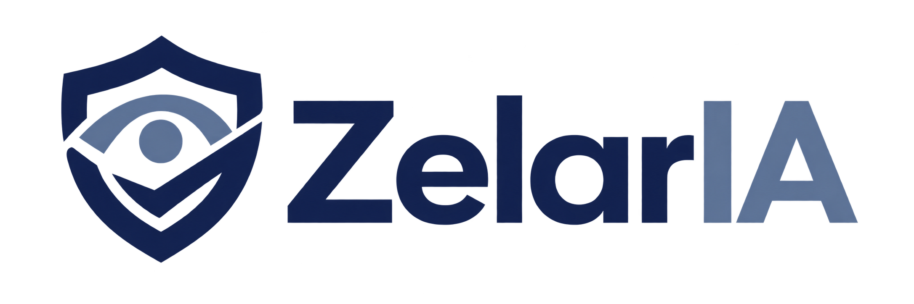

<p align="center">
  
</p>

<p align="center"><strong>Visão computacional para auxiliar na identificação de equipamentos de proteção individual.</strong></p>

O ZelarIA é um protótipo acadêmico desenvolvido em Python com YOLO, OpenCV e CustomTkinter. Utiliza a câmera para detectar pessoas e identificar cinco tipos de EPIs: **capacete, máscara, jaleco, luvas e óculos de segurança**.

A interface apresenta pessoas detectadas, equipamentos confirmados e pendências por pessoa. Quando os cinco tipos são confirmados na mesma pessoa, exibe um aviso verde de **ACESSO LIBERADO**. O protetor auricular está desativado.

Documentação revisada em **25/11/2026**, conforme a configuração V5 instalada.

## Executar no Windows

Com o ambiente e os modelos já presentes na pasta, abra `Iniciar_ZelarIA.cmd` ou execute na raiz do projeto:

```powershell
.\.venv\Scripts\python.exe main.py
```

Se precisar criar o ambiente, use um Python compatível com as versões de `requirements.txt` e execute:

```powershell
python -m venv .venv
.\.venv\Scripts\python.exe -m pip install -r requirements.txt
.\.venv\Scripts\python.exe main.py
```

As dependências têm versões fixadas em [requirements.txt](requirements.txt). A instalação das bibliotecas não fornece os datasets nem todos os pesos personalizados: mantenha os arquivos de modelos descritos abaixo na raiz do projeto.

A aplicação usa a câmera de índice `0` e solicita resolução de **1280 × 720**, quando suportada. A inferência atual usa CPU, em processo separado da interface. O botão **Encerrar** e o X fecham a janela, o aviso de acesso e o processo de câmera/inferência.

## Contagem e regra de acesso

- São contados tipos de EPI por pessoa; duas luvas contam como um tipo.
- **Confirmados + pendentes = quantidade de pessoas × 5.**
- A liberação exige os cinco tipos, incluindo jaleco, na mesma pessoa em dois quadros consecutivos processados.
- EPIs de pessoas diferentes não são somados para liberar alguém. Pessoas incompletas continuam com pendências.
- O aviso não bloqueia a câmera e fecha ao perder a condição ou ficar três segundos sem confirmação recente.
- Fechar o aviso manualmente evita sua reabertura contínua enquanto a mesma condição permanecer.

Os identificadores P1/P2 são locais ao quadro; não há identificação persistente de pessoas. A associação usa a posição das caixas detectadas. Objetos soltos podem ser detectados, mas não satisfazem a regra de acesso sem uma pessoa associada aos cinco tipos. Falta de detecção significa **não confirmado**, não necessariamente ausência do equipamento.

## Modelos e configuração atuais

Os pesos ativos são combinados conforme [calibracao.json](calibracao.json):

| Arquivo | Função na configuração V5 |
| --- | --- |
| `sh17_ppe.pt` | Detecção principal de pessoas e óculos |
| `cabeca_v3_inicial_ultimo.pt` | Especialista em máscara |
| `cabeca_v3_inicial.pt` | Especialista em capacete |
| `sh17_small_v5.pt` | Especialista em luvas, com pesos SH17 maiores previamente treinados |
| `jaleco.pt` | Especialista em jaleco, com limiar recalibrado |
| `epis_v5_best.pt` | Leitura complementar de capacete, máscara e óculos grandes em outra escala |

A leitura complementar usa escala `0.45`. A supressão de caixas repetidas preserva classes diferentes, permitindo detectar máscara e óculos sobrepostos. O recorte experimental por pessoa (`zoom_pessoas`) está **desativado**.

A aplicação procura o modelo principal na ordem `best.pt`, `sh17_ppe.pt`, `yolo11n.pt`. Atualmente usa `sh17_ppe.pt`; colocar um `best.pt` na raiz altera essa seleção. A calibração dos especialistas é específica do modelo principal SH17. `yolo11n.pt` é uma alternativa de detecção de pessoas, não um substituto completo dos cinco EPIs. `maos_ouvidos.pt` foi preservado como histórico e não é carregado pela configuração atual.

## Testar uma imagem e verificar o código

```powershell
.\.venv\Scripts\python.exe -m test.testar_modelo --imagem "C:\caminho\foto.png"
.\.venv\Scripts\python.exe -m unittest discover -s test -p "test_*.py" -v
```

O teste de imagem usa o mesmo detector da câmera, informa pessoas e pendências no terminal e salva a prévia em `deteccao/<nome>_resultado.jpg`. O valor padrão `--conf 0.40` preserva os limiares calibrados por classe; alterá-lo desloca esses limiares. A pontuação mostrada pelo modelo não é uma garantia de acerto.

Na verificação realizada em **20/11/2026**, passaram **37 testes automatizados**. Esse resultado verifica comportamentos do código e não representa a acurácia visual do modelo.

## Treinamento V5

Os conjuntos atuais ficam em `dataset/v5_epis_distancias/` e `dataset/v5_jaleco_distancias/`. O primeiro treina capacete, máscara, óculos e luvas; o segundo treina jaleco separadamente. As bases ficam em `test/bases/`.

Verifique imagens, anotações e separação dos grupos antes de treinar:

```powershell
.\.venv\Scripts\python.exe -m test.treinar_distancias --alvo epis --verificar
.\.venv\Scripts\python.exe -m test.treinar_distancias --alvo jaleco --verificar
```

Para iniciar novos treinos com as bases preservadas:

```powershell
.\.venv\Scripts\python.exe -m test.treinar_distancias --alvo epis --epochs 12
.\.venv\Scripts\python.exe -m test.treinar_distancias --alvo jaleco --epochs 8
```

Use `--base "C:\caminho\peso.pt"` para iniciar um novo ajuste a partir de pesos compatíveis. `--retomar "C:\caminho\last.pt"` aceita checkpoints de treinos interrompidos, não de treinos já concluídos. Os resultados ficam em `relarotio/treinos/`; novos candidatos **não substituem automaticamente os modelos ativos**.

Foram concluídas 12 épocas de cabeça/mãos e 8 de jaleco na etapa V5, com variações de escala, cor, closes e oclusões parciais. Nem todo peso novo foi ativado: foram mantidos modelos anteriores quando apresentaram melhores resultados. No jaleco, o ganho instalado veio da recalibração do peso anterior.

Não troque uma imagem mantendo a anotação da foto anterior. Os conjuntos V5 possuem manifestos e listas de validação/teste filtradas por auditoria de duplicatas próximas. O treino histórico utilizou a validação anterior a essa limpeza. As fotos de produtos fornecidas para treino não são um teste independente. Os scripts antigos continuam em `test/`, mas podem exigir outros conjuntos e classes; para o fluxo atual, use `treinar_distancias`.

## Resultados e limitações

Avaliação exploratória registrada em **20/11/2026**, com 54 imagens de cabeça/mãos e 12 de jaleco, cada uma em versão original, reduzida e recortada; correspondência mínima entre caixas de IoU `0.5`:

| EPI | Detecções corretas antes → depois | Falsos positivos antes → depois |
| --- | --- | --- |
| Capacete | 19 → 20 | 12 → 4 |
| Máscara | 71 → 82 | 28 → 28 |
| Óculos | 7 → 13 | 1 → 2 |
| Luvas | 49 → 61 | 17 → 17 |
| Jaleco | 19 → 31 | 3 → 3 |

Nos closes com máscara e óculos juntos, os pares detectados passaram de **0/15 para 4/15**; na variante distante, permaneceram em **1/25**. Esses números são contagens, não percentuais de acurácia geral. Consulte o [relatório completo da V5](relarotio/treinos/v5_distancias/relatorio.html) e os arquivos de métricas na mesma pasta.

Ainda há falhas em objetos pequenos, distantes, parcialmente encobertos e produtos soltos. No teste das quatro fotos originais de produtos, somente o capacete foi detectado corretamente; também ocorreram falsos positivos. As distâncias foram simuladas em imagens e não medidas em metros na webcam. O conjunto de avaliação foi consultado durante o desenvolvimento, e parte dos dados públicos pode ter participado do pré-treino; os resultados não constituem validação independente.

O aviso de acesso é uma demonstração da regra visual do protótipo. A detecção não certifica uso correto, vedação ou adequação do EPI ao risco e não substitui a avaliação de segurança.

## Organização dos arquivos

| Caminho | Conteúdo |
| --- | --- |
| `main.py` | Interface gráfica e coordenação da aplicação |
| `Iniciar_ZelarIA.cmd` | Inicialização no Windows |
| `test/` | Detector, captura, avaliação, aviso de acesso, testes e scripts de treino |
| `test/caminhos.py` | Caminhos centrais de dados, bases e resultados |
| `test/bases/` | Pesos iniciais preservados para treinamento |
| `dataset/` | Imagens, anotações, manifestos e configurações dos conjuntos |
| `assets/` | Logo e recursos gráficos |
| `docs/` | Apresentação e documentação acadêmica |
| `relarotio/` | Relatórios, backups e resultados de treino |
| `deteccao/` | Prévias dos testes com imagens |
| `*.pt` e `calibracao.json` | Modelos e configuração na raiz |
| `requirements.txt` e `.venv/` | Dependências e ambiente Python local |

O nome `relarotio` corresponde à pasta existente e foi preservado. Os caminhos internos partem da localização dos arquivos do projeto, permitindo iniciar a aplicação fora da pasta raiz.
